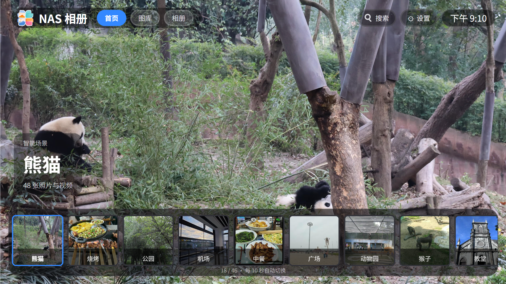
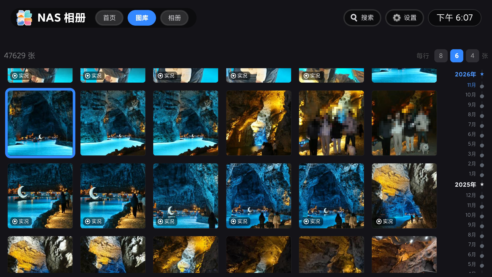
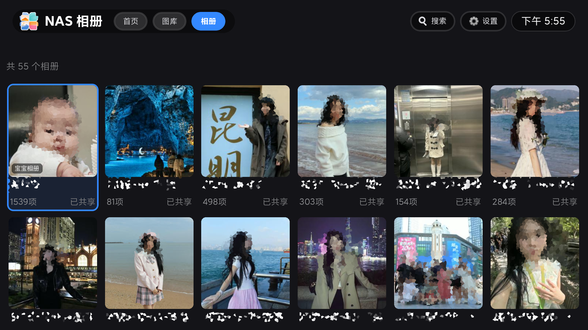
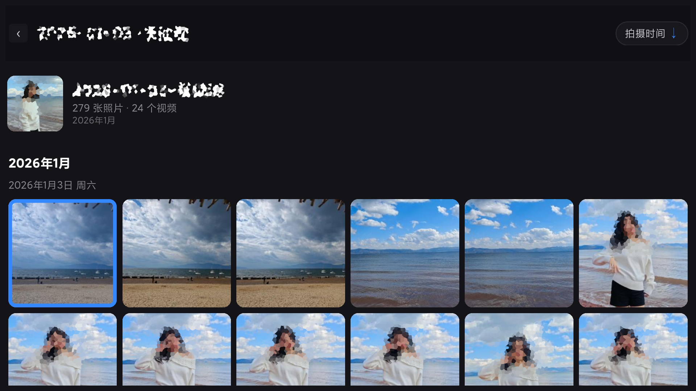
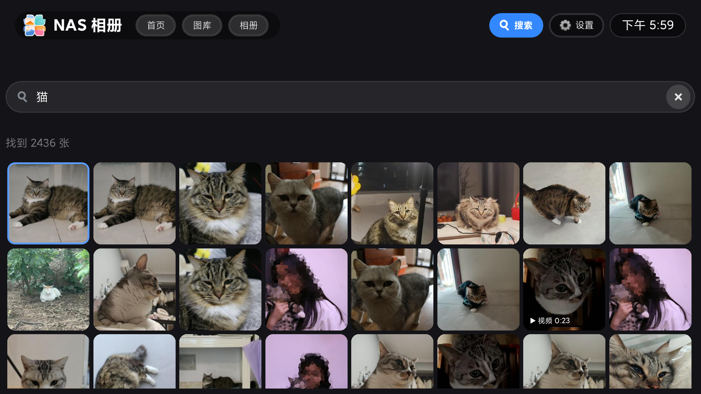
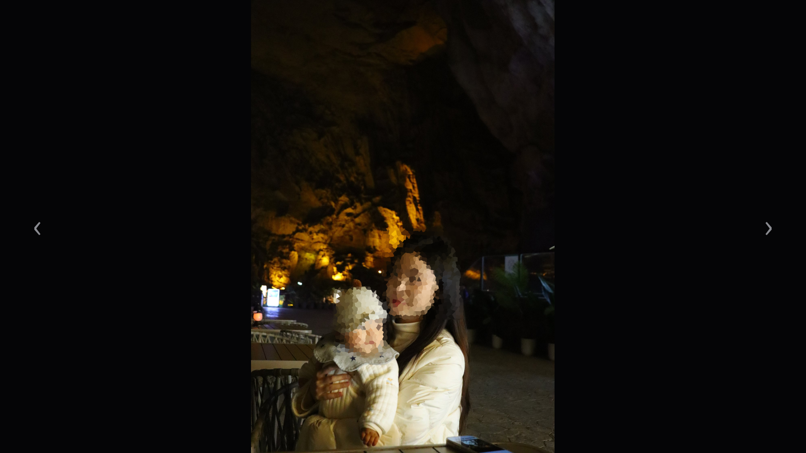
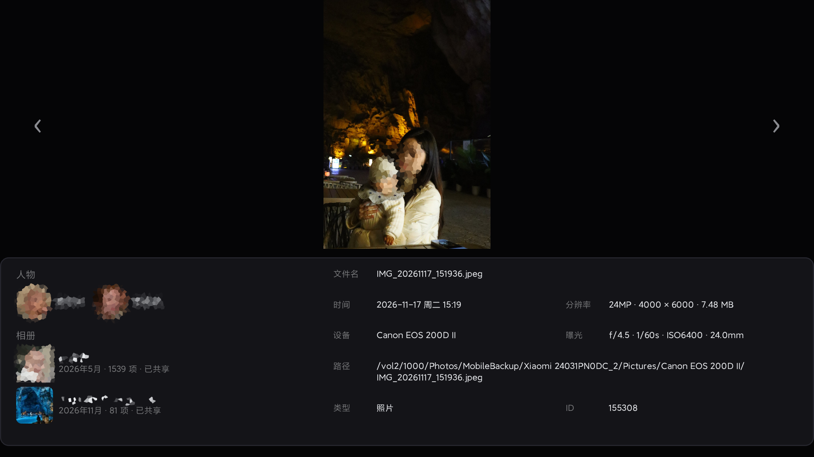
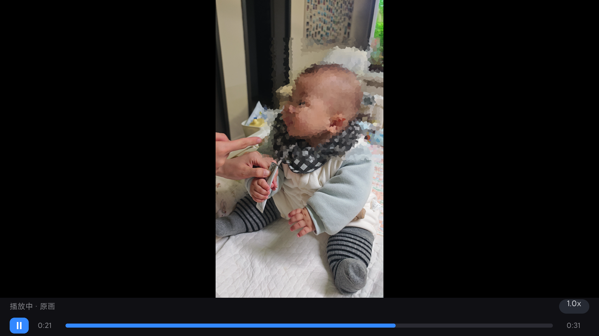
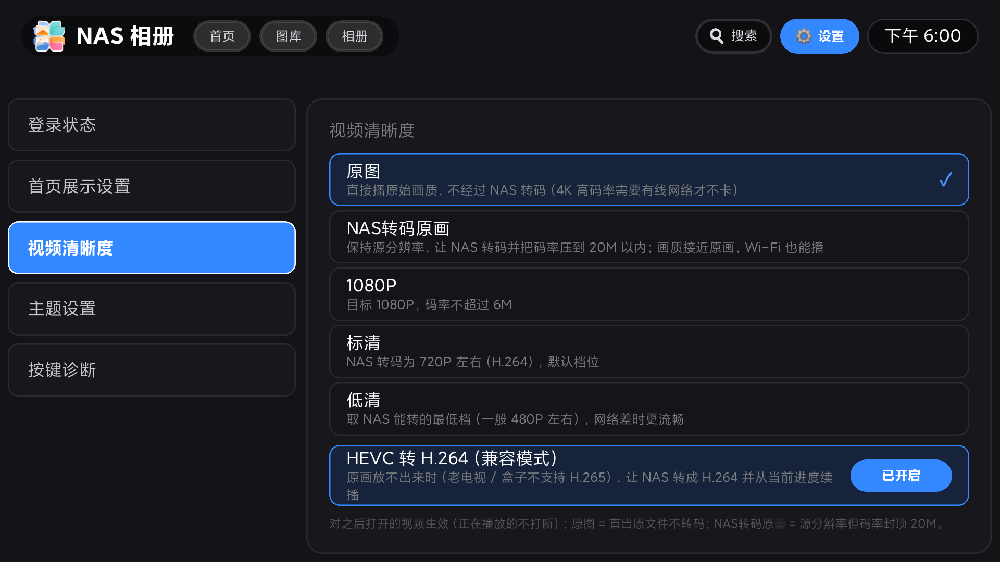
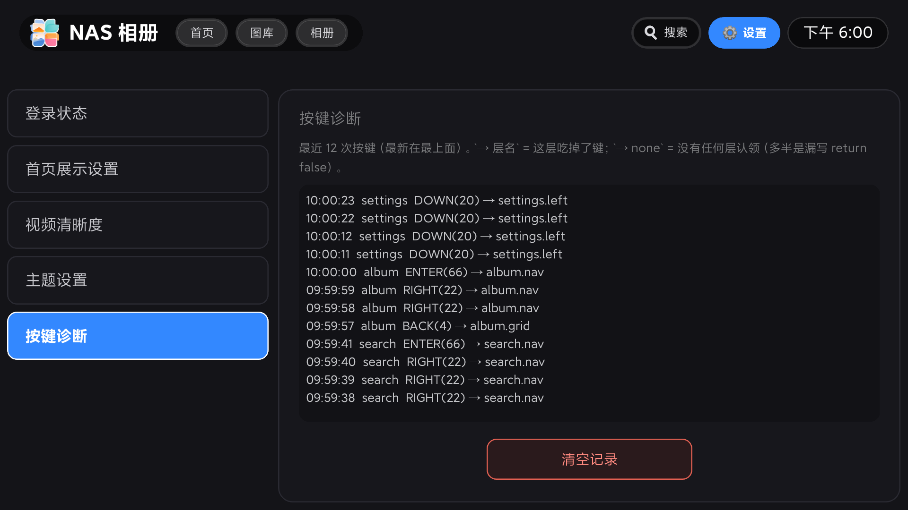

# NasPhotoTV

<p align="center">
  
</p>

<p align="center">
  飞牛 fnOS 相册的第三方 Android TV 客户端 · uni-app x（uvue + UTS/Kotlin 混编）
</p>

<p align="center">
  
  
  
  
</p>

面向电视大屏与遥控器操作，覆盖「浏览照片 / 查找照片 / 播放视频」三条主线：

- 登录协议与实现思路参考 [SMTM-PH/NasPhotoTV](https://github.com/SMTM-PH/NasPhotoTV)（Kotlin + Compose 原生版）；
- 本项目将其移植为 **UTS 插件（Kotlin 混编）**，uvue 只负责 UI 与交互；
- 接口行为以真实 fnOS 实例为准逐条核对，不是纸面实现；个别接口的返回结构仍在补全（见「已知问题」）。

> 本项目为社区第三方客户端，与飞牛（fnOS）官方无关。项目不收集、不上传任何照片或账号信息，所有请求直连你自己的 NAS。

---

## 目录

- [界面预览](#界面预览)
- [1. 功能特性](#1-功能特性)
- [2. 版本规划](#2-版本规划)
- [3. 环境要求](#3-环境要求)
- [4. 安装与运行](#4-安装与运行)
- [5. 目录结构](#5-目录结构)
- [6. 技术架构](#6-技术架构)
- [7. 接口与协议要点](#7-接口与协议要点)
- [8. 调试与测试](#8-调试与测试)
- [9. 已知问题与限制](#9-已知问题与限制)
- [10. 安全说明](#10-安全说明)
- [11. 贡献](#11-贡献)

## 界面预览

> 以下截图取自 Android TV 真机（1920×1080），全程只用遥控器操作。

| 首页大屏 | 图库 |
| :---: | :---: |
|  |  |
| 智能场景海报 + 实时时钟 + 底部卡片托盘 | 按天分组网格、视频 / 实况角标、年 / 月时间轴 |

| 相册列表 | 相册内页 |
| :---: | :---: |
|  |  |
| 封面卡片、照片 / 视频数量、共享与宝宝相册标记 | 相册信息头部 + 按日期分组网格、升降序切换 |

| 搜索 | 照片查看器 |
| :---: | :---: |
|  |  |
| 关键词搜索，8 列结果网格 + 类型角标 | 全屏浏览，左右切换，退出回到原位置 |

| 照片详情 | 视频播放 |
| :---: | :---: |
|  |  |
| 文件名、分辨率、相机参数、所属相册与人物 | 五档清晰度、进度 / 倍速，状态行显示实际档位与码率 |

| 设置 · 视频清晰度 | 设置 · 按键诊断 |
| :---: | :---: |
|  |  |
| 五档切换 + HEVC 兼容开关 | 电视上直接查看按键分发轨迹 |

## 1. 功能特性

| 模块 | 说明 |
| --- | --- |
| 连接登录 | HTTP（默认 5666）/ HTTPS（默认 5667，自签证书 TOFU）；WebSocket 加密登录换取 AccessToken；访问码网关；冷启动自动重登 |
| 两步验证 | token 为空且服务端要求时，在同一连接内提交动态码（`user.2fa.loginVerify`） |
| 登录设备 | NAS 设备管理页显示为 `TV-NAS Photo TV`（`TV` 为设备类型，`NAS Photo TV` 为客户端名） |
| 首页大屏 | 智能场景全屏海报 + 右上实时时钟 + 底部横向卡片托盘，默认 10 秒自动轮播；OK 进入场景（按场景名跳到搜索），返回键弹出退出确认 |
| 图库 | 按天分组网格（8 / 6 / 4 列可切）、视频时长与实况角标、右侧年 / 月时间轴、遥控器光标选择、向上补页 |
| 相册 | 封面卡片列表（共享 / 宝宝相册角标）→ 内页（相册信息头部 + 分页网格、按年 / 月与日期分组、按拍摄时间升 / 降序切换） |
| 搜索 | 导航栏进入，关键词搜索（fnOS 智能搜索）；结果 8 列正方形网格、分批渲染，视频 / 实况角标与图库一致 |
| 查看器 | 图片（双缓冲，先中图后原图）、视频、实况片段、详情面板（文件名 / 大小 / 分辨率 / 相机 / 曝光 / 定位 / 所属相册 / 人物）；图库、相册内页、搜索共用同一组件 |
| 视频播放 | 本机回环代理取流（补 `AccessToken`、透传 `Range`、重写 m3u8）、进度拖动、±10 秒、倍速、五档清晰度（原图 / NAS转码原画 / 1080P / 标清 / 低清，默认标清） |
| 片尾与重播 | 播放器不回调结束事件时由客户端看门狗收尾（状态行「已结束 · OK 重播」）；按 OK 从 0:00 重播，可反复重播；竖屏视频按解码信息补旋转 |
| 实况照片 | 打开后自动播放动态片段，播完回到静态图；`isLive` 按服务端枚举码解析，不当作布尔值 |
| 视频兼容 | 可选「HEVC 转 H.264」开关：原画解码失败时请 NAS 转码 HLS，并从当前进度续播（默认关闭） |
| 设置页 | 左右 3:7 布局：登录状态（服务端校验）、退出登录、视频清晰度五档、HEVC 开关、按键诊断；首页展示设置与主题设置为占位 |
| 遥控器 | 统一按键分发层（唯一按键码定义 + 层级栈 + 连按去抖 + `[keys]` 日志）；方向键移动、OK 确认、返回键逐级回退；查看器内独占按键通道 |
| 性能 | 缩略图窗口化（只下载并持有可见区域位图）、相册内页虚拟列表（只渲染约 108 张）、图库照片上限 240 张、搜索结果每批 80 张 |

## 2. 版本规划

| 版本 | 范围 | 状态 |
| --- | --- | --- |
| **1.0** | 登录 / 两步验证、图库、相册、首页大屏、查看器、视频播放、实况照片、AI 搜索、设置页、遥控器操作（11 项） | ✅ 已实现，[v1.0.0](https://github.com/hjs785053766/nasphoto-tv-uniappx/releases/tag/v1.0.0) 已发布 |
| **2.0** | 首页展示内容自定义、主题切换、相册页顶部功能栏、首页托盘缩小、健壮性增强（5 项） | 📋 计划中 |
| **3.0** | AI 照片评价（1 项） | 📋 计划中 |

### 2.1 需求实现状态

> 状态说明：✅ 已实现 · 🚧 部分完成 · 📋 计划中 · ❌ 未实现

#### 1.0 · 已实现（11 项全部完成）

| 编号 | 需求 | 状态 | 说明 |
| --- | --- | --- | --- |
| T1 | 图片查看器 | ✅ 已实现 | 全屏看图、左右切换、查看信息，退出回到原位置 |
| T2 | 视频与实况照片 | ✅ 已实现 | 播放 / 暂停、快进快退、倍速、进度；实况照片自动播放片段 |
| T3 | 月份级时间轴跳转 | ✅ 已实现 | 右侧按年 / 月列出时间轴，一键跳到对应时间段 |
| T4.1 | 首页大屏 | ✅ 已实现 | 登录落地页：场景大图轮播 + 实时时钟 + 底部卡片 |
| T4.2 | 相册功能 | ✅ 已实现 | 相册列表与相册详情，可按拍摄时间正序 / 倒序浏览 |
| T4.3 | 设置页 | ✅ 已实现 | 第一版：登录状态、退出登录、视频清晰度、视频兼容开关 |
| T4.4 | 搜索 | ✅ 已实现 | 关键词搜索，结果网格展示，可直接打开查看 |
| T4.6 | 视频清晰度五档 | ✅ 已实现 | 原图 / NAS转码原画 / 1080P / 标清 / 低清，默认标清 |
| T4.8 | HEVC 转 H.264 | ✅ 已实现 | 解不了时改用兼容格式续播，默认关闭、可手动开启 |
| T4.9 | 登录设备展示 | ✅ 已实现 | NAS 设备管理里显示「NAS Photo TV / TV」 |
| T5 | 遥控器操作方式 | ✅ 已实现 | 方向键移动、OK 确认、返回键逐级退回，各页一致 |

> 11 项全部 ✅；T5 于 2026-11-25 通过真机遥控器验收。T4.8 的兜底链因测试机支持 HEVC 硬解，尚未在真机上触发过。

#### 2.0 · 规划中（5 项，其中 T6 部分完成）

| 编号 | 需求 | 状态 | 说明 |
| --- | --- | --- | --- |
| T4.5 | 首页展示内容 | 📋 计划中 | 内容来源（推荐场景 / 相册 / 标签 / 搜索）、顺序或随机播放、铺满或完整显示、每张停留 5 / 10 / 30 秒、是否允许电视休眠 |
| T4.7 | 主题设置 | 📋 计划中 | 暗夜 / 白昼 / 飞牛三套配色，全页面统一切换并记忆选择 |
| T4.10 | 相册页顶部功能栏 | 📋 计划中 | 顶部新增人物、地点、标签、收藏、视频五个入口 |
| T4.11 | 首页托盘缩小 | 📋 计划中 | 自动轮播时底部卡片托盘缩小一半，把焦点让给当前大图 |
| T6 | 健壮性 | 🚧 部分完成 | 断网重试、加载失败占位、登录过期自动重登（后一项 ✅，前两项 ❌） |

#### 3.0 · 规划中（1 项）

| 编号 | 需求 | 状态 | 说明 |
| --- | --- | --- | --- |
| T7 | AI 照片评价 | 📋 计划中 | 查看器里显示每张照片的 AI 评分与一句话点评，设置页可开关 |

## 3. 环境要求

| 项 | 要求 |
| --- | --- |
| 构建工具 | **HBuilderX 4.25+**（UTS 插件依赖 HBuilderX 编译，不支持 CLI / npm 构建） |
| 运行平台 | 仅 Android（`app-android`），面向 Android TV / 电视盒子，也可在手机上运行 |
| 应用包名 | `com.grfntv` |
| 系统版本 | minSdk 21 / targetSdk 32；ABI：`arm64-v8a`、`armeabi-v7a` |
| 服务端 | 飞牛 fnOS，形如 `http://<NAS_HOST>:5666`（HTTPS 为 5667，自签证书可用） |
| 账号 | 需自备 fnOS 账号；已开启两步验证的账号可正常登录 |
| 真机调试 | 电视盒子开启 adb：`adb connect <TV_IP>:5555`，再用 HBuilderX 运行到设备 |
| 协议脚本 | Node.js 20+，无第三方依赖 |
| 本地离线打包（可选） | Windows 10/11 x64 + PowerShell 5.1，脚本自带 JDK / Android SDK / Gradle 下载 |

## 4. 安装与运行

### 4.1 直接安装预编译包

已签名的 1.0 安装包发布在 [Releases](https://github.com/hjs785053766/nasphoto-tv-uniappx/releases/latest)：`NasPhotoTV-release-1.0.apk`（约 17.6MB），下载后可直接安装到电视盒子：

```
adb connect <TV_IP>:5555
adb install -r NasPhotoTV-release-1.0.apk
```

安装后从电视桌面（Leanback）或应用列表中打开，填写 NAS 地址、端口、账号、密码即可登录。

> `apk/` 目录不入库（已在 `.gitignore` 中排除），本地自行构建的包放在该目录下即可。

### 4.2 源码运行

1. 用 HBuilderX 4.25+ 打开工程，在 `manifest.json` 中重新获取 AppID；
2. 运行到 Android 设备 / 自定义基座（电视盒子需先 `adb connect`）；
3. 在连接页填写 NAS 地址、端口、账号、密码（如启用访问码需一并填写），点击「登录 / 测试连接」；
4. 登录成功后进入首页大屏，通过顶部导航切换图库 / 相册 / 搜索 / 设置；
5. 连接信息会被保存，之后启动自动登录；AccessToken 只保存在内存，失效时自动重登。

> 工程内不预置任何账号密码，请使用自己的账号登录。

### 4.3 本地离线打包（可选）

`打包脚本/` 提供 Windows 下的本地打包工具（把 HBuilderX 导出的资源打成已签名 APK）。分两步：

1. 在 HBuilderX 中手动执行「发行 → 原生App-本地打包 → 生成本地打包App资源」；
2. 运行 `打包脚本\setup.ps1` 完成环境安装（首次约下载 1.5 GB，之后可离线），再运行 `打包脚本\打包.bat`。

工具的详细说明见 `打包脚本/AGENT.md`。插件源码改动后必须先重新导出资源，再打包。

## 5. 目录结构

```
pages/index/index.uvue          连接页：协议 / 地址 / 端口 / 账号 / 密码 / 访问码、两步验证、自动登录
pages/home/home.uvue            首页大屏：智能场景海报 + 实时时钟 + 底部卡片托盘（自动轮播）
pages/library/library.uvue      图库：日期分组网格（8/6/4 列）+ 年/月时间轴 + 遥控器光标 + 向上补页
pages/library/ThumbImage.uvue    缩略图组件（异步下载 + 本地缓存 + 失败重试）
pages/album/album.uvue          相册列表：封面卡片 + 数量 / 共享 / 宝宝角标
pages/album/detail.uvue         相册内页：相册信息头部 + 分页网格（虚拟列表）+ 升降序切换
pages/search/search.uvue        搜索：深色搜索框 + 8 列结果网格（分批渲染）+ 类型角标
pages/settings/settings.uvue    设置页：登录状态 / 视频清晰度 / 按键诊断，其余两项占位

components/NavBar.uvue          共用导航栏：品牌 + 分区标签 + 搜索 / 设置 + 实时时间
components/PhotoViewer.uvue     共用查看器：图片 / 视频 / 实况 / 详情面板 + 遥控器按键
components/LazyThumb.uvue       窗口化缩略图：只在可见区域内下载并持有位图
common/photo.uts                照片类型与时长、角标工具（页面与查看器共用）
common/scene.uts                首页场景类型
common/video.uts                清晰度五档与 HEVC 开关常量（纯函数）
common/keys.uts                 遥控器按键码唯一定义 + 分发层（层级栈 / 连按去抖 / 轨迹记录）

uni_modules/fnos-auth/
  utssdk/interface.uts                  对外类型定义（新增 API 必须同步）
  utssdk/app-android/index.uts          Promise 封装（JSON ↔ 类型对象）
  utssdk/web/index.uts                  Web 实现（经同源代理，不实现登录协议）
  utssdk/app-android/FnOsLogin.kt       登录 / 两步验证 / 签名 / 图库 / 相册 / 搜索 / 详情 / 缩略图 / 视频
  utssdk/app-android/FnOsCrypto.kt      MD5 / AES / RSA
  utssdk/app-android/FnOsTls.kt         自签证书 TOFU
  utssdk/app-android/FnOsWebSocket.kt   最小 RFC6455 客户端
  utssdk/app-android/FnOsHttp.kt        HTTP / HTTPS + cookie
  utssdk/app-android/FnOsTvKeys.kt      遥控器按键 Hook（Window.Callback 委托）
  utssdk/app-android/FnOsMediaProxy.kt  本机回环媒体代理（补鉴权头、透传 Range、重写 m3u8）

static/                         图标与 logo（app 内使用；web 端同源直出）
nativeResources/android/        原生清单覆盖（TV Leanback 入口等，云打包 / 自定义基座生效）
打包脚本/                       Windows 本地离线打包工具（模板 + 一键脚本）
apk/                            本地打包输出（不入库，发行包见 Releases）
docs/screenshots/               README 使用的真机界面截图

index.html / main.ts / main.uts / vite.config.js   入口与浏览器调试用 dev 代理
manifest.json / pages.json / App.uvue              工程配置与 App 入口
tools/fnos-probe.mjs            协议回归脚本（登录、图库、相册、缩略图鉴权）
tools/fnos-search.mjs           搜索接口自测脚本
tools/fnos-video.mjs            视频清晰度自测脚本
tools/fnos-login.mjs / get-token.mjs   Node 侧登录与取 token
```

## 6. 技术架构

### 6.1 分层

```
uvue 页面 / 组件   ── 只做 UI 与交互
        │  uni_modules/fnos-auth（UTS 接口 + Promise 封装）
        ▼
Kotlin 插件        ── 协议、加密、网络、缓存、媒体代理、按键
```

- 登录、签名、缩略图缓存、视频取流全部在 Kotlin 侧完成；页面不直接拼接 NAS 地址。
- Web 端仅用于调试 UI：浏览器只请求同源 `/nas/*`，由 dev 代理代持 `AccessToken` 并计算签名。加密登录流程与本地缩略图缓存仅在 Android 端实现。

### 6.2 关键设计

| 主题 | 做法 |
| --- | --- |
| 跨语言调用 | Kotlin ↔ UTS 只传 JSON 字符串，Kotlin 侧统一切回主线程回调 |
| 缩略图 | `<image>` 无法携带请求头，因此由插件带 `AccessToken` 下载到本地缓存，再把本地路径交给组件；失败时补 `file://` 重试 |
| 视频播放 | 所有播放地址经本机回环代理（`127.0.0.1`）转发，避免 `<video>` 请求头在部分设备上丢失导致 401 |
| 清晰度 | 原图直链不转码；其余档位按目标短边 + 码率上限向 NAS 申请转码 HLS，经同一代理播放 |
| 播不了的兜底 | 原画解码失败时按「转码 H.264 → 下载后本地播放」顺序降级，每级只尝试一次 |
| 片尾收尾 | ExoPlayer 对 moov 在尾部的渐进式 mp4 不会回调 `@ended`（会停在片尾一直报缓冲），因此由客户端看门狗判定「位置贴到片尾且停住超过 2.5 秒 = 播完」 |
| 重播 | 必须「卸载 → 更换 `<video>` 的元素 id → 重建 → 延后 play」：uni 的原生播放器按元素 id 复用实例，只清 src 或 `seek(0)` 都会沿用停在片尾的那个实例 |
| 竖屏视频 | NAS 转码流（TS）不带旋转信息，客户端按 `decode/info` 的 `videoStreamInfo[0].rotation` 补 90°；原画由 ExoPlayer 自行处理 |
| 按键通道 | 统一包装 `window.callback`，包装器常驻、退订带订阅 id，页面在 `onLoad` / `onShow` 各订阅一次 |
| 内存安全 | 按键 Hook 的静态引用使用 `WeakReference`，避免持有已销毁的 Activity |
| 尺寸 | 全工程以 `750rpx = 屏宽` 为基准；图库格子为正方形，行高常量与格子尺寸、时间轴行高常量与样式必须同步 |

### 6.3 性能与内存

真机日志与内存采样驱动的三项优化，均保留在代码中：

| 位置 | 做法 | 效果 |
| --- | --- | --- |
| 图库 / 搜索网格 | `LazyThumb` 只让可见窗口内的格子下载并持有位图，离开窗口立即释放 | 缩略图不再随滚动无限累积 |
| 相册内页 | 虚拟列表：只渲染视口附近 18 行（约 108 张），上下用 spacer 撑起真实内容高度，坐标体系不变 | 实测内存与掉帧优于改造前，按键滚动不再越来越卡 |
| 图库数据 | 已加载照片上限 240 张（约 4 屏），超出从远端丢弃并按高度补偿滚动位置 | 长距离向上翻页不会攒出上千个节点 |
| 搜索结果 | 结果存全量、只渲染前 N 批（每批 80 张），滚到底或按下键再追加 | 数千条结果也能秒开 |

### 6.4 开发约定

- 工程为 VDOM 模式（`manifest.json` 中 `uni-app-x.vapor = false`），页面脚本使用 `<script setup lang="uts">`；
- 新增接口按四步走：Kotlin 方法 → `interface.uts` 类型 → `app-android/index.uts` Promise 封装 → 页面调用；
- 插件保持**零第三方依赖**（加密用 Android JCE，HTTP 用 `HttpURLConnection`，WebSocket 为手写实现）；
- uvue 样式为 CSS 子集：文字需放在 `<text>` 内，优先 flex + rpx，避免 `gap`、伪类、后代选择器；
- 模板里不要直接调用从其他模块 import 的函数（编译成 `unref(fn)(arg)` 会报错），把值预先算进数据项；
- 本地存储只写字符串，读取时按枚举比较并把非法值回落默认值；
- `SALT` / `SECRET` / 加密信封 / 签名顺序与 NAS 对齐，不应随意改动；
- 明文 HTTP 已在插件 `AndroidManifest.xml` 中放开（`usesCleartextTraffic`）；
- 涉及 Kotlin 的改动必须重新运行 Android 基座，浏览器热刷新不覆盖原生代码；
- 需要让 `<video>` 彻底重来（重播 / 换清晰度 / 换源）时，必须同时更换元素 id（`videoElId`）并重建实例；
- 遥控器按键统一走 `common/keys.uts`：`KEY_*` 常量 + `dispatchKey` 层级栈 + `KeyDebounce`，页面里不允许再出现 `code == 19` 这类字面量。

## 7. 接口与协议要点

| 接口 | 要点 |
| --- | --- |
| 登录 | `WS /websocket?type=main`：`util.crypto.getRSAPub` 取公钥 → AES-256-CBC + RSA 信封发送 `user.login` → 返回 44 位 token |
| 两步验证 | token 为空且 `isBindTwofaSecret` 为真时，在同一连接发送 `user.2fa.loginVerify` |
| 媒体鉴权 | `/p/api/v1/stream/...` 只认 `AccessToken` 请求头（URL 参数与 cookie 均返回 401）；原视频支持 `Range`（206 + `Content-Range`） |
| 业务签名 | `md5(SALT_path_nonce_毫秒时间戳_md5(payload)_SECRET)`，业务码 5000 时切换编码方式重试 |
| `gallery/getList` | 参数 `start_time` / `end_time` / `mode=index` / `limit` / `offset`；`count`、`hasNext` 恒为 null，分页以「本页条数 < limit」判定结束 |
| `gallery/timeline` | 按天倒序返回 `{year,month,day,itemCount}`，累计 itemCount 即 getList 的 offset，用于年 / 月时间轴 |
| `album/list` | 相册列表（封面、照片 / 视频数、共享标记、宝宝相册标记），不返回 `total`，本机 54 个一次拉完 |
| `album/item` | 相册内页头部信息，字段与 `album/list` 一项同构 |
| `album/photos` | 相册内页数据源，列表项与 `gallery/getList` 同构（含缩略图、实况、时长），支持升降序与分页 |
| `user/info` | 用于校验登录态；401 或业务码非 0 视为未登录，`name` 比本地保存的账号更权威 |
| `ai-smart-rec/categories` | 首页数据源，`mainCategory=scene` 返回场景列表与海报信息（54 个场景），海报地址按流地址规则拼接 |
| `video/decode/*` | `decode/info` 列出可选清晰度；`decode/play` 申请转码（签名使用请求体原文），返回 m3u8 路径，与 `decode/stream` 直接拼接 |
| `magic-search/do` | 智能搜索：POST `{"keyword":"...","antiFilters":[]}`，签名基于请求体原文；返回结构做了容错解析 |
| 时间与单位 | 时间格式为 `2026:11:02 17:27:09`；视频时长为秒；缩略图 `xxs/xs/s/m` 四档，网格使用 `s` |

## 8. 调试与测试

### 8.1 协议回归

任何涉及接口的改动前后建议执行：

```
FNOS_USER=<账号> FNOS_PASS=<密码> node tools/fnos-probe.mjs
```

覆盖：登录 → 存储统计 → 时间轴 → 图库列表 → 相册列表 → 相册信息 → 相册照片 → 缩略图鉴权。
其中缩略图鉴权应表现为「无请求头 401、带请求头 200、URL 参数 401」；相册列表不返回 `total` 属正常现象。

另有独立脚本：

```
node tools/fnos-search.mjs <关键词>   # 搜索接口返回结构
node tools/fnos-video.mjs             # 各清晰度档位申请与转码流鉴权
```

### 8.2 浏览器调试

浏览器只用于调整 UI 与交互，验证不了视频播放与本地缓存。前置条件：

1. `node_modules` 为指向 HBuilderX 内置依赖的目录联接（网络盘 / 映射盘不支持 junction）；
2. 项目根存在 `vite.config.js` 时需显式启用 uni 插件链；
3. `resolve.extensions` 包含 `.uvue` / `.uvx` / `.uts`；
4. 入口为 `index.html` + `main.ts`；
5. 为根元素设置 rem 基准（`1rpx = 1/32rem`）。

登录与鉴权由 dev 代理完成，凭据仅保存在本地（进程内存 + 浏览器 `localStorage`），不进入仓库与构建产物。修改 `vite.config.js` 后需重启 dev server。

浏览器还可以用**物理键盘模拟遥控器**（方向键 / Enter / Backspace 等），是电视连不上基座时的主要调试手段。

### 8.3 真机验证清单

1. 登录 → 首页 → 图库，首屏缩略图全部加载；
2. 遥控器：上下滚动、进入时间轴、选年 / 月跳转、返回键逐级回退；上键到顶 / 返回键先把焦点交给顶栏，顶栏里再按返回才离开本页；
3. 查看器：点开任意一张 → 左右各翻 10 张（跨分页边界仍可继续）→ 查看详情 → 返回后滚动位置不变、无黑屏；
4. 实况：首次进入自动播放且有声音，播完回到图片，OK 键可重播；
5. 视频：进入不自动播放，OK 播放 / 暂停，左右各按一次约 10 秒，倍速循环切换，退出后无残留声音；
6. 片尾与重播：播到结尾状态行变「已结束 · OK 重播」且不转圈；按 OK 从 0:00 重新播放，连着播完两三次都正常；
7. 清晰度：五档切换后画面差异明显，均可拖动进度；状态行显示实际档位与码率；
8. 图库滚到顶部：月份标题贴住顶栏、无空白带；向上滚动可连续加载更早照片；
9. 相册内页：长列表滚动、翻多页后内存稳定，返回列表不丢位置；
10. 改过 Kotlin / 清单 / 原生依赖后需重新安装基座并复测。

## 9. 已知问题与限制

- **向上补页体验**：连续加载更早照片时，视口落点偶尔会跳动，后续继续优化。
- **HEVC 兜底验证**：HEVC 转 H.264 的失败降级链路在支持 HEVC 硬解的设备上不会触发，尚未在仅支持 H.264 的设备上验证。
- **浏览器限制**：Web 端只播放原画，清晰度五档与 HEVC 兜底无法在浏览器中验证。
- **片尾判定是客户端估算**：播放器对部分文件不发「播放结束」事件，客户端按「位置贴片尾且停住 2.5 秒」判定播完；若片尾正好长时间缓冲，可能提前显示「已结束」（重新播放即可）。
- **重播实现依赖元素 id**：`<video>` 的 id 会在重播时更换（`pw-video-<n>`），改动播放器模板时要保留这个机制，否则重播会停在片尾。
- **搜索接口结构**：解析按「先找照片数组、再按图库字段容错」实现，服务端结构调整时需同步核对。
- **遥控器兼容性**：早期版本在部分电视盒子上出现过按键整体失效，根因是订阅 id 撞车 + 包装器被系统摘掉，已修复并在真机验收；若其它机型复现，先看 `[keys]` 日志与设置页的「按键诊断」。
- 仅支持 Android；iOS / 鸿蒙需另写 UTS 实现。
- 图库数据量可达数万条、单日上万条，分页与按天分组是必要设计，不支持全量拉取。

## 10. 安全说明

- `SALT` / `SECRET` 硬编码于客户端，`authx` 仅用于防篡改，不构成强认证；
- 为支持冷启动自动重登，登录密码以明文存于 SharedPreferences，生产环境建议改用 Android Keystore 加密；
- 请勿将账号、密码、token 提交到仓库；本地调试凭据请通过环境变量或本地未跟踪文件提供；
- 本项目不收集、不上传任何照片或账号信息；所有请求均直连你的 NAS。

## 11. 贡献

欢迎提交 Issue 与 Pull Request。提交前请：

1. 运行 `tools/fnos-probe.mjs` 确认协议行为未变；
2. 确认 `git diff` 中不含任何账号、密码、token；
3. 新增接口已在 `interface.uts` 中声明类型；
4. 已完成一次 Android 基座编译与真机自测。
